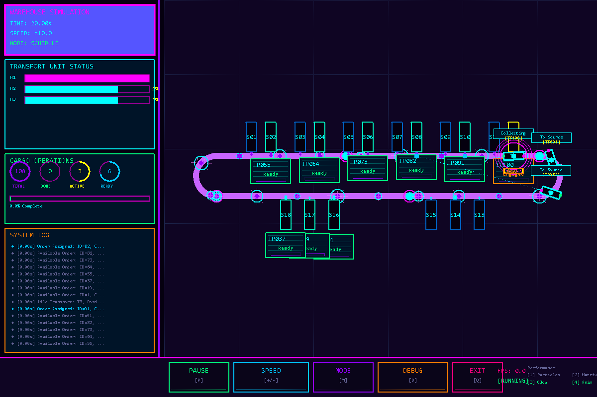

# 环形仓储穿梭车仿真

*A C++ warehouse shuttle simulator from SDU Automation coursework.*

[](CMakeLists.txt)
[](docs/USAGE.md)
[](LICENSE)

**108 条运输订单，18 个站点，3 / 5 / 7 辆穿梭车。** 从车辆启停、货物准备到订单分配，用一个可运行的 C++ 项目观察仓储运输系统如何协同工作。

项目来自**山东大学控制科学与工程学院自动化专业《高级程序设计与实践》课程、2025 年第七届“学以致用”编程能力大赛**。在已完成的课程代码基础上整理模块、构建入口和文档，适合寻找山大自动化课程资料，或学习 C++ 状态机与仿真的同学。[课程背景与参数](docs/COURSE.md)



*程序渲染的界面预览，展示轨道、站点、车辆和实时信息。*

## 可以做什么

- **调度模式 `schedule`**：执行 54 条入库、54 条出库订单，选择 3、5、7 辆车，观察装卸、等待和设备状态变化。
- **巡游模式 `patrol`**：三辆车以随机目标速度运行，查看运动和停车状态。
- **EasyX 图形界面**：保留原课程项目的霓虹轨道、车辆动画、侧栏和交互菜单。
- **无图形运行**：使用固定种子重复运行，保存生效配置和任务/设备日志。
- **按模块阅读**：核心与绘图分开，能从订单、几何或状态机中的一个模块开始学习。

调度沿用**最近正向距离贪心策略**，工程整理保留主要算法与旧界面。原实现存在车距、巡游圈数及到站运动等近似，阅读或改进前请看[实现限制](docs/LIMITATIONS.md)。

## 快速开始

需要 CMake 3.20 及以上和支持 C++17 的编译器。默认构建不需要 EasyX。

```sh
git clone https://github.com/wallley/warehouse-transport-sim.git
cd warehouse-transport-sim
cmake -S . -B build -DBUILD_GUI=OFF
cmake --build build --config Release
ctest --test-dir build -C Release --output-on-failure
```

Windows / Visual Studio 构建后，在 PowerShell 运行：

```powershell
.\build\Release\WarehouseTransportCLI.exe --mode schedule --cars 3 --seed 42 --max-seconds 10800 --output outputs/schedule-3
```

Linux 等单配置构建运行：

```sh
./build/WarehouseTransportCLI --mode schedule --cars 3 --seed 42 --max-seconds 10800 --output outputs/schedule-3
```

运行输出保存在指定目录，其中 `runtime-config.json` 记录最终生效参数。结果、编译产物和 IDE 缓存不纳入仓库。[更多参数与输出说明](docs/USAGE.md)

## 打开图形界面

在 Windows 上准备 Visual Studio 2022 的 C++ 工具及 [EasyX](https://easyx.cn/setup)，然后构建：

```powershell
cmake -S . -B build-gui -G "Visual Studio 17 2022" -A x64 -DBUILD_GUI=ON
cmake --build build-gui --config Release
.\build-gui\Release\WarehouseTransportSystem.exe
```

若未自动找到 EasyX，在配置命令中添加 `-DEASYX_ROOT="<EasyX目录>"`。[安装、键鼠操作及预览生成](docs/USAGE.md)

## 从哪里读代码

| 想了解什么 | 从这里开始 |
| --- | --- |
| 车辆、站点和订单有哪些状态 | [`include/warehouse/model.hpp`](include/warehouse/model.hpp) |
| 轨道距离、弯道和限速如何计算 | [`src/geometry.cpp`](src/geometry.cpp) |
| 18 个站点和 108 条订单如何初始化 | [`src/scenario.cpp`](src/scenario.cpp) |
| 空闲车辆如何领取订单 | [`src/dispatch.cpp`](src/dispatch.cpp) |
| 车辆如何运动、装卸和等待 | [`src/motion.cpp`](src/motion.cpp)、[`src/station.cpp`](src/station.cpp) |
| 一个仿真步怎样串起这些模块 | [`src/simulation.cpp`](src/simulation.cpp) |
| 原界面如何绘制 | [`src/rendering.cpp`](src/rendering.cpp)、[`src/effects.cpp`](src/effects.cpp) |

完整模块关系见[架构说明](docs/ARCHITECTURE.md)。

## 学习与交流

初次阅读可以按“[课程问题](docs/COURSE.md) → [运行一次](docs/USAGE.md) → 状态模型 → 单步仿真 → [算法边界](docs/LIMITATIONS.md)”的顺序开始。欢迎通过 [Issue](https://github.com/wallley/warehouse-transport-sim/issues) 讨论运行问题、课程理解或改进思路，提交修改前请看[贡献指南](CONTRIBUTING.md)。

如果这个项目帮助你理解课程或找到资料，欢迎点一个 **Star**，也方便以后回来继续阅读。

## 许可与公开范围

代码和文档以 [MIT License](LICENSE) 开放。公开内容保留学校、专业与课程出处，省略真实姓名、学号、具体班级、联系方式和本机目录；不附课程原文、旧报告或运行结果文件。[发布与维护说明](docs/PUBLISHING.md)
