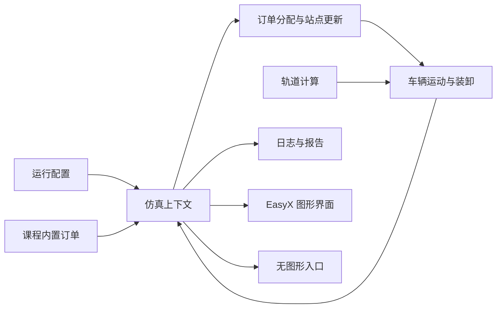

# 工程结构与模块接口

## 设计目标

这次整理围绕已有课程代码展开：将原单文件按职责拆成独立编译单元，保留主要算法和界面。工程分为可移植仿真核心与 Windows/EasyX 图形前端，无图形入口直接调用同一套核心逻辑。

## 模块边界

| 模块 | 职责 | 输入与输出 |
| --- | --- | --- |
| 配置与模型 | 轨道常量、订单/站点/车辆状态、运行配置 | 明确的数据结构，不依赖图形库 |
| 仿真上下文 | 运行时集合、时钟、日志与随机状态 | 一次仿真实例持有全部可变运行状态 |
| 轨道计算 | 环形位置归一化、前向距离、弯道识别与限速 | 数值输入，数值/布尔输出 |
| 场景与订单 | 初始化 18 个站点、车辆和 108 条课程订单 | 仿真上下文和车辆数，写入模型集合 |
| 调度与运动 | 站点状态转换、订单分配、安全距离、加减速和装卸 | 显式上下文及模型集合，更新状态 |
| 日志与报告 | 任务执行、设备变化、运行记录和分析文本 | 仿真上下文，输出到指定目录 |
| 仿真入口 | 初始化与单步执行 | 运行配置，返回更新后的上下文及完成状态 |
| EasyX 前端 | 原菜单、轨道/站点/车辆绘图、键盘和动画 | 显式仿真上下文与界面状态 |
| 无图形前端 | 固定种子、限定仿真时长的可重复运行 | 命令行参数，保存最终配置和运行输出 |

## 数据流

## 迁移约束

不把多个源文件直接包含到一个大文件中，不用全局可变别名模拟模块化。原函数可以保留命名，但读取或修改运行状态时必须接受上下文。图形颜色在核心中以普通整数保存，核心不包含 graphics.h/windows.h。局部静态可变缓存转为实例状态。随机数保存在实例中，使用与原 MSVC rand 相同的序列机制，显式保存种子，方便原版对照。

## 验证与边界

模块拆分需编译所有独立编译单元，并对原始代码的状态转换和仿真轨迹进行对照。课程要求、实现行为和优化设想分开表述。GUI 验证与无图形测试分别记录，持续集成的核心测试通过不能自动代表 EasyX 图形构建已通过。
